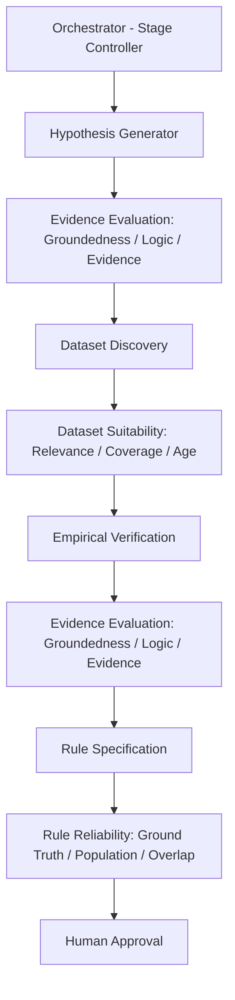
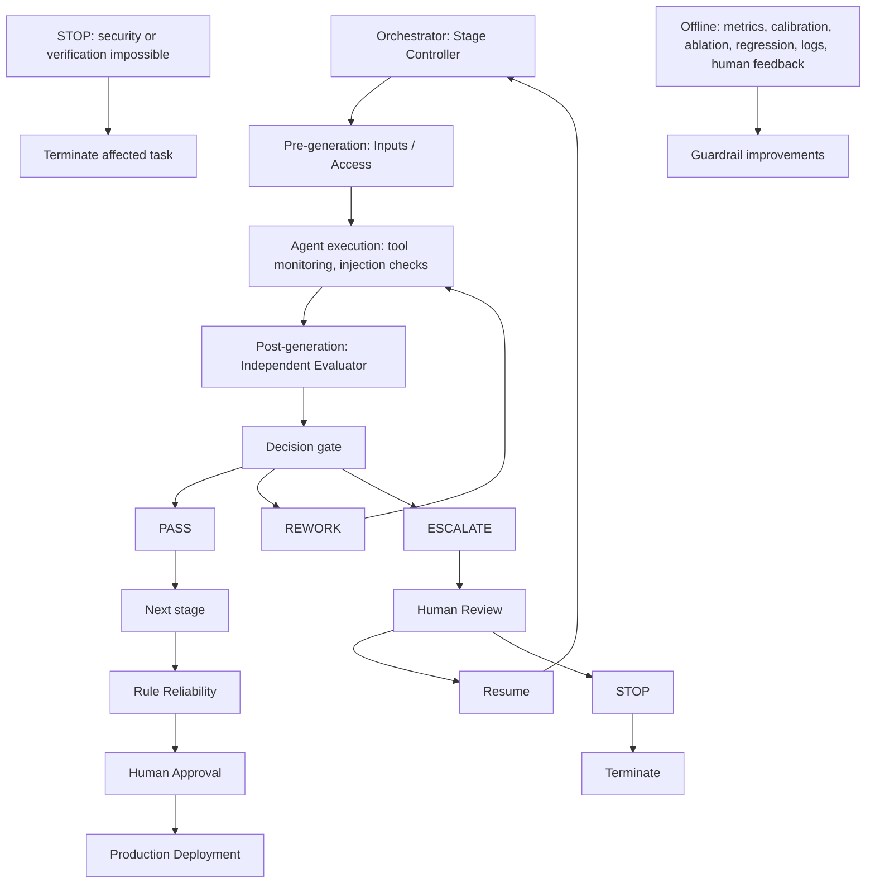

# Safety & Intervention Plan

**Agentic Threat Detection Research System**

## 1. System Purpose and Safety Risks

Specialized agents research, validate, and propose rules for identifying AI-driven browser sessions. An Orchestrator controls the sequential pipeline.

| Risk source | Failure mode |
|---|---|
| Task Instructions | Ambiguous objectives or missing constraints produce irrelevant hypotheses. |
| Execution History | Unsupported claims, reasoning errors, and overconfidence propagate downstream. |
| Environment Observations | Unreliable sources, outdated fingerprints, or unsuitable datasets corrupt conclusions. |

**Security:** Prompt injection, goal hijacking, memory poisoning. **Impact:** Cascading failures and incorrect rules causing false positives or false negatives.

## 2. Guardrails and Behavioral Constraints

| Stage | Controls |
|---|---|
| Pre-generation | Validate inputs, research scope, and tool permissions. |
| During-generation | Monitor tool calls, detect injection, enforce execution limits. |
| Post-generation | Independent evidence and stage-specific validation. |

Pre-generation and during-generation controls apply to every agent; post-generation checks depend on the stage.

## 3. Evaluation Metrics and Testing

| Metric | Measurement |
|---|---|
| Hallucination Rate | Unsupported claims / factual claims |
| Overconfidence Rate | Incorrect or unsupported high-confidence claims / high-confidence claims |
| Groundedness | Source-supported claims / factual claims |
| Error Propagation | Upstream errors repeated downstream / upstream errors introduced |
| Detection Recall | TP / (TP + FN), against labeled errors |
| False Positive Rate | FP / (FP + TN), against labeled valid outputs |
| Calibration | ECE: weighted confidence–accuracy gap across bins |

Claims require independent source-based labels; propagation uses claim IDs. Calibration requires explicit confidence estimates and observed outcomes.

| Test | Method |
|---|---|
| Ablation | Compare none, pre-only, during-only, post-only, and all guardrails on identical cases. |
| Adversarial | Inject misleading evidence, contradictions, prompt injection, and poisoned history. |
| Regression | Rerun fixed cases after prompt, model, or guardrail changes. |

Detection rule quality is evaluated separately using ground truth, matched population analysis, and rule overlap.

## 4. Human Intervention Criteria

| Decision | Trigger | Action |
|---|---|---|
| PASS | Required checks pass | Advance |
| REWORK | Correctable validation failure | Return to responsible agent |
| ESCALATE | Contradictions, repeated failures, high-risk findings | Suspend; human review |
| STOP | Verification impossible or security violation | Terminate affected task |

Retry limits prevent infinite rework. Triggers, supporting evidence, and decisions are logged.

## 5. Integrated Safety Strategy

The evaluator reports results; only the Orchestrator changes workflow state. Human review can resume or terminate a suspended task.

## 6. Design Trade-offs

| Decision | Benefit | Cost |
|---|---|---|
| Stage gates | Limit error propagation | Latency |
| Independent evaluation | Reduce shared bias | LLM cost |
| Three-layer guardrails | Cover multiple failure stages | Complexity |
| Strict thresholds | Reject unsupported outputs | Rework |
| Human approval | Control production changes | Less autonomy |
| Audit logging | Support investigations | Storage |

Asynchronous research prioritizes correctness over latency.

## 7. Agent Deployment, Observability and Health

| Owner | Responsibility / authority |
|---|---|
| Orchestrator | Workflow, retries, stage transitions, escalation; sole workflow authority. |
| Research Agents | Assigned research tasks within tool permissions. |
| Independent Evaluator | Validation results; cannot advance workflow. |
| Observability Service | Traces, metrics, logs, alerts; cannot modify research outputs. |
| Human Operator | Escalation decisions, deployment approval, rollback. |

| Monitoring area | Metrics |
|---|---|
| Execution health | Availability, completion rate, latency, timeouts, retries |
| Reliability | Hallucination, groundedness, propagation, rejection rate |
| Resources | Tokens, LLM calls, cost per research cycle |
| Traceability | Agent versions, tool calls, evaluations, transitions |

| Control | Policy |
|---|---|
| Pre-deployment | Version prompts, models, guardrails; require regression and adversarial tests. |
| Canary | Release to a limited set of research tasks. |
| Runtime | Suspend failed tasks, limit retries, alert on degradation. |
| Rollback | Operator restores prior version when thresholds are breached. |

Research agents cannot bypass gates, change deployment configurations, or modify production detection rules.
