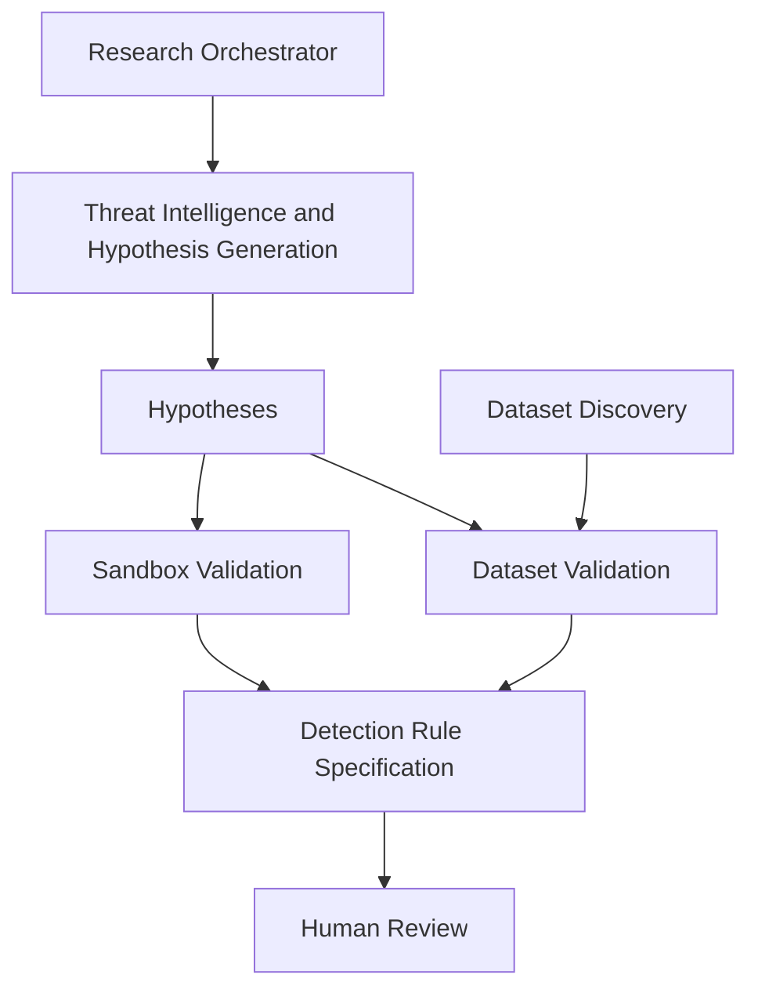

# Multi-Agent Coordination

**Autonomous Threat Detection Researcher for Agentic Commerce**

## 1. Architecture

**Coordination model:** Orchestrated, graph-based workflow with predominantly sequential execution, parallel validation, and controlled feedback loops.

The Research Orchestrator manages task dependencies, parallel validation, and feedback loops. Dataset Discovery maintains the dataset registry independently and supplies datasets for validation. Failed or incomplete results return for further investigation.

## 2. Multi-Agent Architecture — Rationale

- **Stage-gated pipeline:** Defined inputs, outputs, and acceptance criteria. Validation gates prevent unsupported results from progressing downstream.
- **Specialization:** Task-specific expertise, context, and tools. Restricted access reduces unnecessary context and unintended actions.
- **Reliability:** Independently verifiable outputs, traceable evidence, and isolated retries.

## 3. Agent Roles and Responsibilities

1. **Threat Intelligence & Hypothesis Generation:** Researches AI shopping agents, identifies detection signals, and formulates evidence-backed hypotheses.
2. **Dataset Discovery:** Discovers datasets, evaluates suitability, and maintains the dataset registry.
3. **Dataset Validation:** Tests hypotheses against labelled datasets and measures signal prevalence and false-positive rates.
4. **Sandbox Validation:** Executes agents in a controlled environment and verifies signal reproducibility.
5. **Detection Rule Specification:** Combines validated signals, evaluates detection rules, and produces specifications for human review.
6. **Research Orchestrator:** Assigns tasks, manages dependencies, tracks progress, and coordinates investigations and retries.

## 4. Agent Count and Diminishing Returns

- **MVP:** Six agents, separated by responsibility.
- **Potential expansion:** Split Threat Intelligence & Hypothesis Generation if experiments demonstrate sufficient improvements in research quality to justify execution time and coordination overhead.

## 5. Agent Communication

- **One-way communication:** Structured handoff contracts define inputs, outputs, and acceptance criteria.
- **Feedback loops:** Research Orchestrator returns failed or incomplete results for further investigation.
- **No direct agent-to-agent dialogue.**

## 6. Coordination Trade-offs

- **Research coverage:** Continuous monitoring of evolving AI agent technologies, hypotheses, and datasets.
- **Reliability:** Validated detection rules take priority over execution speed.
- **Latency:** High latency is acceptable; real-time execution is not required.
- **Coordination:** Orchestrator-controlled feedback loops support investigation and revalidation at the cost of additional overhead.

## 7. Scalability

The architecture supports horizontal scaling within individual agent roles by running multiple agents in parallel.

- **Research:** Partition the domain across Threat Intelligence agents as research volume grows.
- **Dataset Discovery:** Parallelize searches across sources or research domains.
- **Validation:** Distribute datasets and sandbox experiments across multiple validation agents.
- **Trade-off:** Scaling individual roles requires additional coordination, task distribution, and result aggregation.
