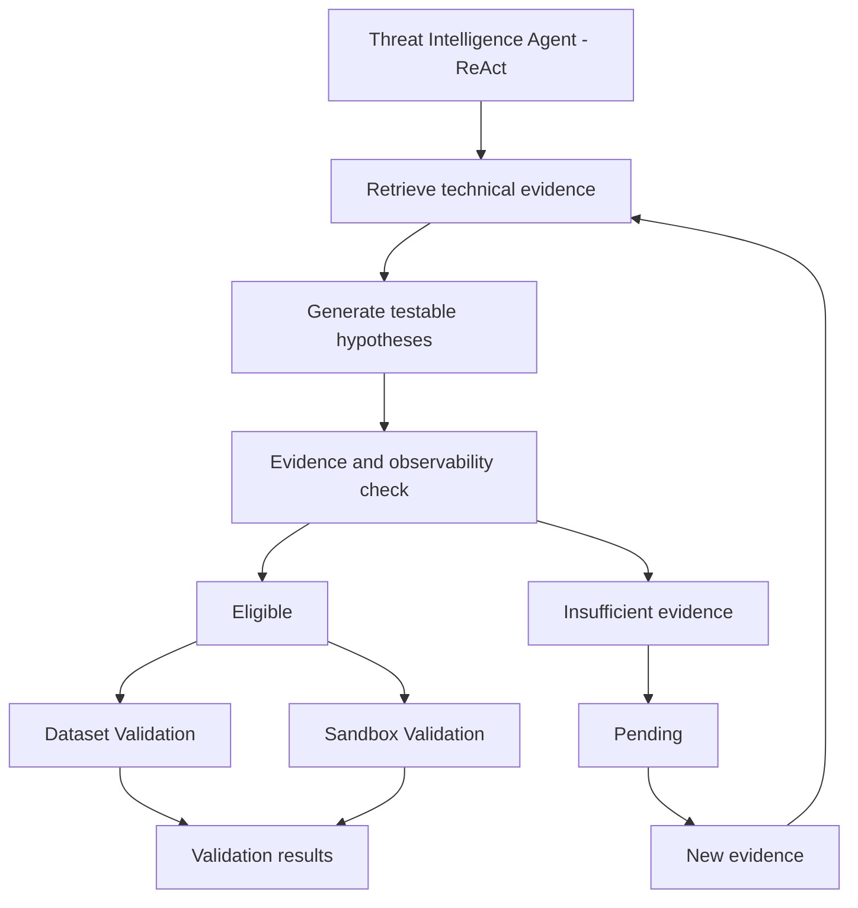

# Reasoning Architecture Decision — Threat Intelligence Agent

**Decision:** Use ReAct without Tree of Thoughts (ToT).

ToT was initially proposed to generate and rank alternative detection hypotheses. We decided against it for three reasons:

1. **Limited number of hypotheses.** We expect few hypotheses per AI shopping technology and can validate each without ranking them first.
2. **Unreliable scoring.** An LLM critic cannot establish whether a signal distinguishes AI agents from human users. This requires measurements from labelled datasets.
3. **Premature rejection.** ToT could discard valid hypotheses based on incomplete evidence before they reach validation.

The Threat Intelligence Agent will use ReAct to research AI shopping technologies and generate hypotheses supported by technical evidence. Each hypothesis will specify observable signals and validation requirements.

## Proposed workflow

Dataset Validation and Sandbox Validation Agents test eligible hypotheses independently. Hypotheses that cannot be tested due to missing data remain pending.

ToT would add LLM-based scoring and selection without removing the need for empirical validation.
