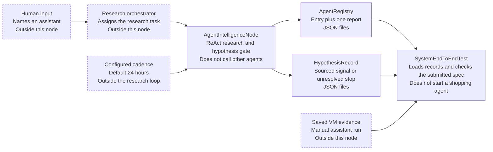

# LOCAL-agent-intelligence Agent intelligence research

Solution skeleton spec

Sources: `requirements/LOCAL-agent-intelligence/` and `requirements/LOCAL-agent-intelligence/plan/design-decisions.md`. `requirements/LOCAL-agent-intelligence/plan/plan.md` waits for human approval because this is a greenfield plan.

---

## Architecture

This change adds one LangGraph node. Human input enters the research orchestrator, which assigns a research task to this node. The node also starts discovery when its configured interval has elapsed. The default interval is 24 hours. Discovery looks for new agents and AI assistants, and for new shopping-session patterns on assistants already in the registry. The ReAct loop writes a registry entry, one human-readable report, and either a sourced hypothesis or an unresolved investigation. JSON files hold those records after the run ends. The node does not call the later stages and does not start a shopping agent. The system end-to-end test reads an orchestrator assignment, those files, a saved virtual-machine evidence record, and saved downstream results, then checks a submitted rule specification for research sources and validation results.

Arrows are runtime flow for this change.

### Building blocks

| Building block | Scope | Boundary | Allowed dependencies |
|----------------|-------|----------|----------------------|
| AgentIntelligenceNode | Run an assigned research task or a scheduled discovery run, apply the hypothesis gate, and choose a registry write | Does not accept human input directly, validate datasets, run the sandbox, evaluate evidence, or submit a rule | Orchestrator assignment, configured interval, LangChain tools, AgentRegistry, HypothesisRecord |
| AgentRegistry | Store one entry and exactly one report per addition | Does not store hypotheses | JSON research store |
| HypothesisRecord | Store a sourced hypothesis or an unresolved investigation, and reject duplicates and abuse classification | Does not invent measurements | JSON research store |
| SystemEndToEndTest | Execute the system path from orchestrator-accepted human input through a submitted rule specification using saved records | Does not launch Muse or another shopping agent and does not deploy a rule | Orchestrator assignment, AgentRegistry, HypothesisRecord, saved VM evidence, saved downstream records |

---

## Decision record

### DD-001 — LangChain ReAct tools inside one LangGraph node

| Field | Recorded value |
|-------|----------------|
| Status | DECIDED |
| Rationale | The accepted framework decision matches the ReAct loop and the one-way stage graph. |
| Evidence | CON-001, CON-002, ASS-ARCH-001, `docs/adr/0001-langchain-langgraph.md`, `docs/specs/Threat_Intelligence_ReAct_Decision.md` |
| Alternatives considered | CrewAI conflicts with one-way records. A custom loop would rebuild tool calling and checkpoints. |
| Consequences | Retrieval and hypothesis drafting stay inside this node. Tree of Thoughts is not added. |
| Affected plan steps | Step 2 |

### DD-002 — JSON files are the research record store

| Field | Recorded value |
|-------|----------------|
| Status | DECIDED |
| Rationale | The MVP needs durable records without a separate database. A vector database is optional. |
| Evidence | QR-002, `docs/specs/Agentic_Commerce_Agent_Design_Reasoning_Loops.md` section 2, `docs/specs/shopping_agent_retrieval_checkpoint_polished(1).md` section 2 |
| Alternatives considered | SQLite adds an engine the MVP does not need. Chat checkpoints do not keep research records after the run. |
| Consequences | Other stages read these files. A later ticket can replace the store. |
| Affected plan steps | Step 1, Step 3 |

### DD-003 — This node writes records and does not call other agents

| Field | Recorded value |
|-------|----------------|
| Status | DECIDED |
| Rationale | Coordination is one-way through stored records. |
| Evidence | CON-003, ASS-ARCH-002, `docs/specs/Multi_Agent_Coordination_Capstone.md` section 5 |
| Alternatives considered | Direct calls to the other agents would be agent-to-agent dialogue. |
| Consequences | The end-to-end test loads downstream results from records. |
| Affected plan steps | Step 2 |

### DD-004 — Sandbox evidence is a saved VM record, with no agent launcher

| Field | Recorded value |
|-------|----------------|
| Status | DECIDED |
| Rationale | Muse cannot be launched by this codebase, and the user kept shopping-agent runs manual for the MVP. |
| Evidence | CON-004, POL-004, ASS-002, user decision 2026-11-19 |
| Alternatives considered | WebArena does not record the client telemetry under test and does not start Muse. Automating browser-use is out of scope for the MVP. |
| Consequences | A missing evidence file blocks the sandbox portion of the system test. Repeatability uses the saved file. |
| Affected plan steps | Step 4 |

### DD-005 — The system end-to-end test asserts a submitted rule specification

| Field | Recorded value |
|-------|----------------|
| Status | DECIDED |
| Rationale | The user set the outcome as a submitted specification with research sources and validation results, and asked for a system end-to-end test. |
| Evidence | REQ-008, QR-003, POL-004, CA-001, user decision 2026-11-19 |
| Alternatives considered | An agent-intelligence-only test would not check that outcome. A live Muse run is out of scope. |
| Consequences | The scenario is written in `integration-test-scenarios.md` after skeleton approval. The test stays red until the other stage records exist. This dependency is the acknowledgement reason. |
| Affected plan steps | Step 4 |

### DD-006 — This node never writes a deployed rule

| Field | Recorded value |
|-------|----------------|
| Status | DECIDED |
| Rationale | The system outcome is a submitted specification, and deployment is out of scope. |
| Evidence | INV-004, REQ-005, user decision 2026-11-19 |
| Alternatives considered | Writing a rule file from this node would skip validation and submission. |
| Consequences | Rule-template fields beyond research sources and validation results belong to the rule-specification work item. |
| Affected plan steps | Step 2 |

### DD-007 — Human input enters through the orchestrator

| Field | Recorded value |
|-------|----------------|
| Status | DECIDED |
| Rationale | The coordination flow starts at the orchestrator, which assigns tasks. The user confirmed that human input feeds the orchestrator. |
| Evidence | REQ-001, CON-008, REQ-008, `docs/specs/Multi_Agent_Coordination_Capstone.md` sections 1 and 3, user decision 2026-11-19 |
| Alternatives considered | A human call directly to this node would bypass the orchestrator. |
| Consequences | A named-assistant investigation waits for an orchestrator assignment. Scheduled discovery does not wait for human input. |
| Affected plan steps | Step 2 |

### DD-008 — Scheduled discovery defaults to 24 hours

| Field | Recorded value |
|-------|----------------|
| Status | DECIDED |
| Rationale | The user required a configurable discovery cadence with a daily default, and the coordination spec calls for continuous monitoring. |
| Evidence | REQ-002, REQ-009, REQ-010, `docs/specs/Multi_Agent_Coordination_Capstone.md` section 6, user decision 2026-11-19 |
| Alternatives considered | Discovery only on human request would miss new assistants and new patterns. A fixed clock with no configuration would ignore the required setting. |
| Consequences | A pattern that is already stored does not create a second hypothesis. Changing the interval changes when the next scheduled run starts. |
| Affected plan steps | Step 5 |

---

## Risks

**Implementation acknowledgement and risks:** Intended readiness is `READY_FOR_IMPLEMENTATION_WITH_ACK`. Implementation waits for skeleton approval and then for acknowledgement. Acknowledgement reason: the system end-to-end test depends on records from the other work items and on a person running the assistant on the sandbox virtual machine.

Carried design risks: 2

| ID | Risk | Effect | Mitigation |
|----|------|--------|------------|
| CA-001 | Dataset validation, sandbox records, independent evaluation, and rule specification are outside this ticket. | REQ-008 cannot pass until those outputs exist. | Specify the scenario now. Keep the test red until the records exist. Do not start a shopping agent to fill the gap. |
| DR-002 | Manual VM runs vary, and a non-shopping assistant may be registered without a hypothesis. | Saved evidence can omit a field, and discovery can add an entry that never becomes a shopping hypothesis. | The test uses one saved evidence file. POL-001 blocks a hypothesis when the sources do not support a shopping-session signal. |
