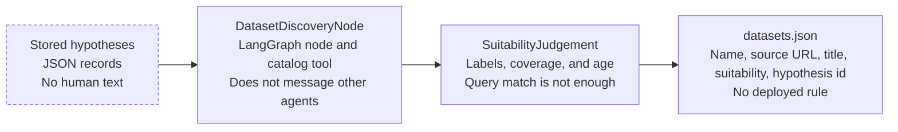

# LOCAL-dataset-discovery Dataset Discovery

Solution skeleton spec

Sources: `requirements/LOCAL-dataset-discovery/` and `requirements/LOCAL-dataset-discovery/plan/design-decisions.md`. The written plan is `requirements/LOCAL-dataset-discovery/plan/plan.md`.

---

## Architecture

This change adds one LangGraph node. The node reads stored hypothesis JSON. It calls a LangChain catalog tool when the 24-hour schedule is due or when a hypothesis has no suitable dataset. In-memory ranking keeps five passages. Suitability requires labels, coverage, license, a verification date within 730 days, and more than a query match. The node writes `datasets.json` with the dataset name, source URL, title, suitability, and hypothesis id, plus the registry facts behind that judgment. Human text is rejected. The node does not research assistants, validate hypotheses, launch a shopping agent, or deploy a rule.

Arrows are runtime flow for this change.

### Building blocks

| Building block | Scope | Boundary | Allowed dependencies |
|----------------|-------|----------|----------------------|
| DatasetDiscoveryNode | Search when the schedule is due or a hypothesis has no suitable entry, and write registry entries | Does not accept human text, research assistants, validate hypotheses, launch a shopping agent, or deploy a rule | LangGraph, LangChain tool, HypothesisReader, DiscoverySchedule, SuitabilityJudgement, DatasetRegistry |
| HypothesisReader | Read hypothesis id and measurement fields from JSON | Does not import agent intelligence and does not store hypotheses | Local `hypotheses.json` |
| SuitabilityJudgement | Mark a candidate suitable only when every check passes | Does not write the registry and does not compute validation metrics | 730-day window |
| DatasetRegistry | Store one entry per dataset name and hypothesis id | Does not judge suitability | Local `datasets.json` |
| DiscoverySchedule | Decide whether a scheduled search is due | Does not search or judge | Configured interval and `lastRunAt` |

---

## Decision record

### DD-001 — One LangGraph node calls one LangChain catalog tool

| Field | Recorded value |
|-------|----------------|
| Status | DECIDED |
| Rationale | ADR 0001 selects LangChain and LangGraph, and coordination forbids agent chat. |
| Evidence | CON-001, ASS-ARCH-001, `docs/adr/0001-langchain-langgraph.md` |
| Alternatives considered | CrewAI or AutoGen conversation would reintroduce agent chat. |
| Consequences | Tests compile a one-node graph and invoke the tool. |
| Affected plan steps | Step 6 |

### DD-002 — JSON records and no import of the other agent packages

| Field | Recorded value |
|-------|----------------|
| Status | DECIDED |
| Rationale | Agents hand off stored JSON, and this ticket must not call the other roles. |
| Evidence | CON-002, CON-003, CON-004, user role for LOCAL-dataset-discovery |
| Alternatives considered | Importing agent intelligence is forbidden and that package is parallel work. |
| Consequences | A structural test rejects those imports. |
| Affected plan steps | Step 1, Step 3, Step 4 |

### DD-003 — Registry entry keeps the handoff fields and the judgment facts

| Field | Recorded value |
|-------|----------------|
| Status | DECIDED |
| Rationale | The user role requires name, source URL, title, suitability, and hypothesis id. The retrieval design also records collection method, labels, license, and verification date. |
| Evidence | REQ-001, INV-001, `docs/specs/shopping_agent_retrieval_checkpoint_polished(1).md` |
| Alternatives considered | Five fields only would hide the facts behind suitability. |
| Consequences | Readers tolerate the extra keys. Suitability is `suitable` or `unsuitable`. |
| Affected plan steps | Step 3 |

### DD-004 — Suitability rule uses a 730-day window

| Field | Recorded value |
|-------|----------------|
| Status | REQUIRES_ACK |
| Rationale | Relevance, coverage, and age are required, and a query match is not enough. The day count is not in the sources. |
| Evidence | REQ-002, REQ-004, INV-002, POL-001, CA-001, ASS-003 |
| Alternatives considered | Title overlap would mark a description match suitable. Dropping unsuitable rows would hide the rejection. |
| Consequences | Tests cover day 730 and day 731. |
| Affected plan steps | Step 2 |

### DD-005 — Hypothesis id and measurement fields use the agreed JSON names

| Field | Recorded value |
|-------|----------------|
| Status | REQUIRES_ACK |
| Rationale | The parallel ticket owns the hypothesis record, and this package cannot import it. Prose measurements do not invent columns. |
| Evidence | REQ-001, CA-002, ASS-002 |
| Alternatives considered | Waiting on an import would violate DD-002. |
| Consequences | An unknown id key is skipped. Prose measurements cannot make a dataset suitable. |
| Affected plan steps | Step 4 |

### DD-006 — Search on the 24-hour schedule or when nothing suitable is stored

| Field | Recorded value |
|-------|----------------|
| Status | DECIDED |
| Rationale | Discovery is scheduled and also fills a registry gap. Latency is acceptable, and 24 hours matches the sibling default. |
| Evidence | REQ-005, retrieval checkpoint section 2, coordination spec section 6 |
| Alternatives considered | Searching on every call ignores the interval after a suitable entry exists. |
| Consequences | A targeted run does not move `lastRunAt`. Tests can set a 1-hour interval. |
| Affected plan steps | Step 5, Step 6 |

### DD-007 — Reject human text and do not launch research, validation, or a shopping agent

| Field | Recorded value |
|-------|----------------|
| Status | DECIDED |
| Rationale | Human input enters only through the orchestrator. This ticket only discovers datasets. |
| Evidence | REQ-006, REQ-007, INV-003, POL-003, POL-004, CON-007, CON-008, CON-009 |
| Alternatives considered | A free-text prompt would add a second human entry point. |
| Consequences | Tests patch process launch and compare the store. |
| Affected plan steps | Step 6 |

### DD-008 — Rank passages in memory from an injected catalog

| Field | Recorded value |
|-------|----------------|
| Status | DECIDED |
| Rationale | In-memory ranking is allowed, and a live search key is not required. |
| Evidence | ASS-004, retrieval checkpoint sections 2 and 4 |
| Alternatives considered | Live Tavily or Exa calls are not repeatable here. |
| Consequences | Rank is lexical. Suitability stays a separate check. |
| Affected plan steps | Step 6 |

---

## Risks

**Implementation acknowledgement and risks:** Intended readiness is `READY_FOR_IMPLEMENTATION_WITH_ACK`. The user ordered this component implemented after the review files exist and supplied `proceed_as_is`. Acknowledgement reason: the 730-day verification window and the hypothesis JSON field names are planning choices because the sources do not state them.

Carried design risks: 3

| ID | Risk | Effect | Mitigation |
|----|------|--------|------------|
| CA-001 | The age check has no day count in the sources. | A 730-day window can disagree with a later product number. | Keep one constant and test day 730 and day 731. |
| CA-002 | Hypothesis field names belong to a parallel ticket. | A different id key is skipped, and prose measurements cannot show coverage. | Accept `id` and `hypothesisId`, and fail coverage closed. |
| DR-003 | The architecture validator has no checks for the LangChain plus LangGraph label and returned low confidence. | The label is not proved by the validator's layout cues. | Follow ADR 0001 and the one-node JSON shape already used by the sibling plans. The ADR does not contradict the user-provided style. |
