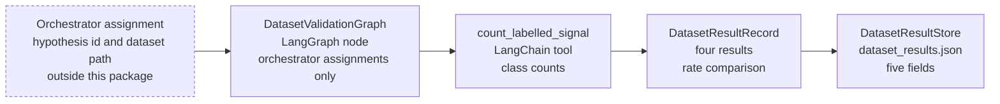

# LOCAL-dataset-validation Dataset Validation

Solution skeleton spec

Sources: `requirements/LOCAL-dataset-validation/` and `requirements/LOCAL-dataset-validation/plan/design-decisions.md`. Plan: `requirements/LOCAL-dataset-validation/plan/plan.md`.

---

## Architecture

This change adds one LangGraph node in the `dataset_validation` package. An orchestrator assignment names a stored hypothesis and a labelled dataset fixture. The node calls a LangChain tool to count the signal on AI and human rows, selects support, contradict, inconclusive, or blocked, and appends one JSON object to `dataset_results.json`. The node does not discover datasets, run the sandbox, write a rule, launch a shopping agent, or talk to another agent.

Arrows are runtime flow for this change.

### Building blocks

| Building block | Scope | Boundary | Allowed dependencies |
|----------------|-------|----------|----------------------|
| Orchestrator assignment | Supplies `source`, `hypothesis_id`, `signal`, and `dataset_path` | Does not measure rows | None in this package |
| `DatasetValidationGraph` | Accepts one assignment, calls the counting tool, and stores one result or nothing | Does not discover datasets, launch a shopping agent, write a rule, or classify abuse | LangGraph, the counting tool, `DatasetResultRecord`, `DatasetResultStore` |
| `count_labelled_signal` | Counts AI and human rows where the named signal is true | Does not choose the result word | LangChain tool decorator and the row list |
| `DatasetResultRecord` | Selects support, contradict, inconclusive, or blocked and checks the stored rates | Does not read the filesystem | None |
| `DatasetResultStore` | Appends and reads `dataset_results.json` | Does not decide the result | The local filesystem |

---

## Decision record

### DD-001 — One LangGraph node calls one LangChain counting tool

| Field | Recorded value |
|-------|----------------|
| Status | DECIDED |
| Rationale | The accepted ADR selects LangChain tools and LangGraph nodes, and the user said not to reopen that choice. |
| Evidence | CON-001, ASS-ARCH-001, `docs/adr/0001-langchain-langgraph.md`, validator confidence high |
| Alternatives considered | Plain functions only, matching the current `research_orchestrator` modules. That would reopen the ADR. |
| Consequences | This package depends on LangChain and LangGraph and does not import `research_orchestrator`. |
| Affected plan steps | Step 1, Step 4 |

### DD-002 — Results are appended to `dataset_results.json`

| Field | Recorded value |
|-------|----------------|
| Status | DECIDED |
| Rationale | The user named that file and those fields, and the orchestrator already persists JSON lists on disk. |
| Evidence | REQ-007, QR-002, CON-004, `research_orchestrator/store.py` |
| Alternatives considered | SQLite. This ticket does not need a query engine. |
| Consequences | A later reader opens the same file. This package does not import the orchestrator store. |
| Affected plan steps | Step 3 |

### DD-003 — Support, contradict, and inconclusive follow a strict rate comparison

| Field | Recorded value |
|-------|----------------|
| Status | REQUIRES_ACK |
| Rationale | The user defined four exclusive results and did not give a numeric cutoff. A strict comparison uses both measured rates. |
| Evidence | ASS-002, POL-002, INV-002, REQ-001, REQ-002, REQ-003, REQ-004 |
| Alternatives considered | Support whenever prevalence is greater than zero. A fixed false-positive ceiling of 0.05. Neither is stated in the sources. |
| Consequences | Equal rates do not count as support. |
| Affected plan steps | Step 2 |

### DD-004 — `dataset_validation` does not import other component packages

| Field | Recorded value |
|-------|----------------|
| Status | DECIDED |
| Rationale | The user forbade imports of other component packages. |
| Evidence | CON-002, CON-003, ASS-003, `tests/test_boundary.py` |
| Alternatives considered | Import the orchestrator store. That couples this package to another component. |
| Consequences | Hypothesis fields arrive on the assignment. |
| Affected plan steps | Step 1 |

### DD-005 — Only an orchestrator assignment may store a result

| Field | Recorded value |
|-------|----------------|
| Status | DECIDED |
| Rationale | Human input reaches this agent only through the orchestrator, and the settled scope excludes discovery, launch, rule writing, and abuse classification. |
| Evidence | REQ-005, REQ-006, POL-003, POL-004, CON-005, `docs/specs/Multi_Agent_Coordination_Capstone.md` section 5 |
| Alternatives considered | Accept any JSON object that names a file. That would let a chat path store a result. |
| Consequences | The orchestrator must set `source` to `orchestrator`. |
| Affected plan steps | Step 4 |

---

## Risks

**Implementation acknowledgement and risks:** READY_FOR_IMPLEMENTATION_WITH_ACK. Implementation waits for `proceed_as_is` or `risk_resolved`. The acknowledgement reason is that support and contradict use a strict comparison of AI prevalence and the human false-positive rate, which the sources do not state as a number, and this package adds a LangGraph node while `research_orchestrator` does not import LangGraph.

Carried design risks: 2

| ID | Risk | Effect | Mitigation |
|----|------|--------|------------|
| ASS-002 | The strict comparison is a planning choice. | Equal rates store inconclusive, not support. | DD-003 stays `REQUIRES_ACK` until the human acknowledges it. |
| DR-001 | `research_orchestrator` does not import LangGraph. | This package takes a dependency the neighboring package does not import. | Follow the ADR in this package only, and do not import `research_orchestrator`. |
