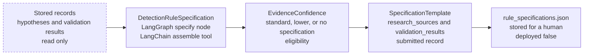

# LOCAL-detection-rule-specification Detection Rule Specification

Solution skeleton spec

Sources: `requirements/LOCAL-detection-rule-specification/` and `requirements/LOCAL-detection-rule-specification/plan/design-decisions.md`. Plan path: `requirements/LOCAL-detection-rule-specification/plan/plan.md`.

This change adds one LangGraph node in package `detection_rule_specification`. The node reads stored hypothesis sources and stored validation results, calls one LangChain tool to assemble a specification, and writes `rule_specifications.json` for a human. The template sections are research sources and validation results. Confidence is standard when both results support the hypothesis, and lower when one supports and the other is inconclusive or blocked and does not contradict. A contradiction or a missing source writes nothing. The record is submitted and not deployed. The package does not research, discover datasets, execute the sandbox, launch a shopping agent, classify abuse or legitimacy, or message another agent.

Arrows are runtime flow for this change.

### Building blocks

| Building block | Scope | Boundary | Allowed dependencies |
|----------------|-------|----------|----------------------|
| `RuleSpecificationStore` | Read hypothesis and validation JSON and write `rule_specifications.json` | Does not choose confidence | Local JSON files |
| `EvidenceConfidence` | Choose standard, lower, or no specification | Does not write files | Stored result strings and sources |
| `SpecificationTemplate` | Build the submitted record with the two evidence sections | Does not decide eligibility | Evidence already accepted |
| `DetectionRuleSpecification` | LangGraph node that reads the store, calls the LangChain tool, and writes one record | Does not research, message agents, or deploy | LangGraph, LangChain, the three blocks above |

---

## Decision record

### DD-001 — One LangGraph node calls one LangChain tool

| Field | Recorded value |
|-------|----------------|
| Status | DECIDED |
| Rationale | ADR 0001 selects LangChain and LangGraph, and this node assembles stored evidence instead of searching. |
| Evidence | CON-001, ASS-ARCH-001, `docs/adr/0001-langchain-langgraph.md`, user instruction 2026-11-20 |
| Alternatives considered | A plain function would drop the accepted framework. A ReAct search loop would research, which this component does not do. |
| Consequences | Tests compile the graph and invoke the tool. The orchestrator package stays unchanged. |
| Affected plan steps | Step 5 |

### DD-002 — JSON files are the read and write contract

| Field | Recorded value |
|-------|----------------|
| Status | REQUIRES_ACK |
| Rationale | The output file name is required, and this package cannot import the writers of the inputs. |
| Evidence | ASS-003, CA-001, REQ-004, CON-002, user settled scope 2026-11-20, `research_orchestrator/orchestrator.py` |
| Alternatives considered | Importing the orchestrator is forbidden. A database does not match the JSON store already used in this repo. |
| Consequences | Tests use `hypotheses.json`, `validation_results.json`, and `rule_specifications.json`. A different sibling file name is the acknowledgement reason. |
| Affected plan steps | Step 4, Step 5 |

### DD-003 — This package imports no other component

| Field | Recorded value |
|-------|----------------|
| Status | DECIDED |
| Rationale | The user limited this component to stored records and the specification file. |
| Evidence | CON-002, CON-003, CON-005, REQ-004, POL-001, user settled scope 2026-11-20 |
| Alternatives considered | Calling the orchestrator for eligibility would import another component. |
| Consequences | A structural test scans the package for those imports and for subprocess. |
| Affected plan steps | Step 1 |

### DD-004 — Result vocabulary matches the stored validation words

| Field | Recorded value |
|-------|----------------|
| Status | DECIDED |
| Rationale | The user defined standard and lower confidence, and the stored result words are already support, inconclusive, blocked, and contradict. |
| Evidence | REQ-001, REQ-002, REQ-003, ASS-002, user settled scope 2026-11-20, `research_orchestrator/orchestrator.py` |
| Alternatives considered | Treating a missing result as inconclusive would lower confidence without the stated condition. Numeric scores were not requested. |
| Consequences | An unrecognized result writes no specification. |
| Affected plan steps | Step 3 |

### DD-005 — The template has two evidence sections

| Field | Recorded value |
|-------|----------------|
| Status | DECIDED |
| Rationale | The settled specification evidence is research sources plus validation results, with submitted true and deployed false. |
| Evidence | REQ-001, INV-001, INV-002, INV-003, user settled scope 2026-11-20 |
| Alternatives considered | Telemetry thresholds from the earlier critique loop are outside the settled template. |
| Consequences | The template rejects a record outside that shape, including an abuse or legitimacy field. |
| Affected plan steps | Step 2 |

### DD-006 — A repeat write keeps one record per hypothesis

| Field | Recorded value |
|-------|----------------|
| Status | DECIDED |
| Rationale | The same stored inputs must leave equal specification records. |
| Evidence | QR-001, QR-002 |
| Alternatives considered | Appending on every run would change the file on the second run. |
| Consequences | One hypothesis has one current row in `rule_specifications.json`. |
| Affected plan steps | Step 4 |

---

## Risks

**Implementation acknowledgement and risks:** READY_FOR_IMPLEMENTATION_WITH_ACK. Implementation may start after the human acknowledgement `proceed_as_is` or `risk_resolved`. Acknowledgement reason: input hypothesis and validation file names are a local contract because this package does not import the components that write them.

Carried design risks: 1

| ID | Risk | Effect | Mitigation |
|----|------|--------|------------|
| CA-001 | Sibling components may store hypothesis sources or validation results under other file names or keys. | This node would write no specification for records it cannot see. | DD-002 records the file names and the `id` and `sources` aliases. Tests use that contract. The user acknowledged proceeding with that risk. |
