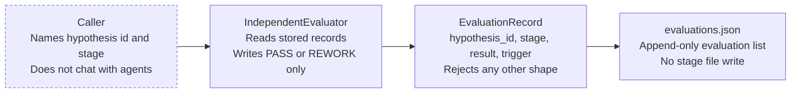

# LOCAL-independent-evaluator Independent Evaluator

Solution skeleton spec

Sources: `requirements/LOCAL-independent-evaluator/` and `requirements/LOCAL-independent-evaluator/plan/design-decisions.md`. `requirements/LOCAL-independent-evaluator/plan/plan.md` is written in this turn because the user ordered the plan written and `skeletonReviewApproved` set true.

---

## Architecture

This change adds one Python package. A caller asks `IndependentEvaluator` to check one hypothesis id at one stage. `EvaluationRecord` shapes the result. The evaluator reads JSON lists already in a directory and appends one object to `evaluations.json`. It does not write a workflow stage file, does not import another component package, and does not start a shopping agent.

Arrows are runtime flow for this change.

### Building blocks

| Building block | Scope | Boundary | Allowed dependencies |
|----------------|-------|----------|----------------------|
| IndependentEvaluator | Read one stage's stored records, apply the PASS rules, and append one evaluation | Does not change workflow stage, classify abuse, launch a shopping agent, message another agent, or write a faculty report | EvaluationRecord, the local JSON directory, the Python standard library |
| EvaluationRecord | Require hypothesis_id, stage, result, and a non-empty trigger, and allow only PASS or REWORK | Does not decide the stage outcome and does not write files | None |
| evaluations.json | Persist the evaluation list after the writing process exits | Does not store stage transitions | Written only by IndependentEvaluator |

---

## Decision record

### DD-001 — One Python package appends evaluations.json

| Field | Recorded value |
|-------|----------------|
| Status | DECIDED |
| Rationale | The applied modules store JSON lists and do not import LangGraph. This package follows that style and does not import other component packages. |
| Evidence | `research_orchestrator/store.py`, `docs/adr/0001-langchain-langgraph.md`, CON-001, CON-006, ASS-ARCH-001 |
| Alternatives considered | A LangGraph runtime in this package, or importing the orchestrator store. Both were rejected. |
| Consequences | A later graph owner can call `evaluate` without this package owning stage transitions. |
| Affected plan steps | Step 1, Step 2, Step 3 |

### DD-002 — PASS or REWORK only, with no stage write

| Field | Recorded value |
|-------|----------------|
| Status | DECIDED |
| Rationale | The user limited result to PASS or REWORK and left stage changes to the research orchestrator. |
| Evidence | User order, INV-001, INV-002, CON-005, CON-007, safety plan sections 5 and 7 |
| Alternatives considered | Storing ESCALATE or STOP, or updating a stage file on REWORK. Both were rejected. |
| Consequences | A contradiction is REWORK here. Suspension stays an orchestrator decision. |
| Affected plan steps | Step 2, Step 3 |

### DD-003 — Contradiction is support with reject

| Field | Recorded value |
|-------|----------------|
| Status | DECIDED |
| Rationale | Support with reject is a contradiction. Support with inconclusive or blocked is not. A missing outcome is missing evidence. |
| Evidence | POL-002, REQ-003, REQ-004, `research_orchestrator/orchestrator.py` `review_validation`, user order |
| Alternatives considered | Treating inconclusive as a contradiction, or treating two rejects as a contradiction. Both were rejected. |
| Consequences | An unrecognized outcome word is missing evidence and is REWORK. |
| Affected plan steps | Step 3 |

### DD-004 — Local input file names

| Field | Recorded value |
|-------|----------------|
| Status | REQUIRES_ACK |
| Rationale | The import ban prevents sharing a store class, so the input names are fixed in this package. |
| Evidence | ASS-002, CON-001, user order |
| Alternatives considered | Guessing file names, or importing `OrchestratorStore`. Both were rejected. |
| Consequences | A parallel writer that uses different names receives REWORK. |
| Affected plan steps | Step 3 |

---

## Risks

**Implementation acknowledgement and risks:** READY_FOR_IMPLEMENTATION_WITH_ACK. Implementation waits until the human acknowledgement decision is `proceed_as_is` or `risk_resolved`. The acknowledgement reason is that input JSON names are local because this package must not import sibling packages.

Carried design risks: 2

| ID | Risk | Effect | Mitigation |
|----|------|--------|------------|
| DR-001 | ASS-002 and DD-004 fix file and field names inside this package. | A sibling store with different names is REWORK. | Acknowledge and keep the names in `IndependentEvaluator`. Do not import the sibling. |
| DR-002 | The ADR accepts LangChain and LangGraph, and the applied modules do not import them. | This package does not register a graph node. | Follow the applied Python JSON-module style. A later graph owner can call `evaluate`. |
