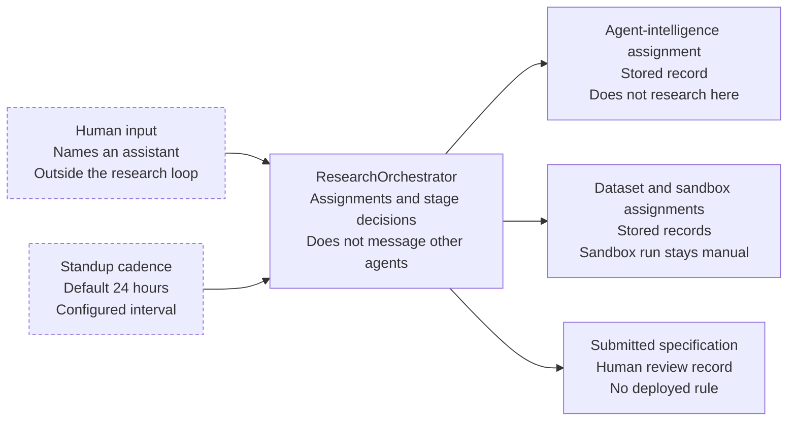

# LOCAL-research-orchestrator Research orchestrator

Solution skeleton spec

Sources: `requirements/LOCAL-research-orchestrator/` and `requirements/LOCAL-research-orchestrator/plan/design-decisions.md`. The written plan is `requirements/LOCAL-research-orchestrator/plan/plan.md`.

---

## Architecture

This change adds one LangGraph node. Human input that names an assistant becomes a stored assignment for agent intelligence. A configured standup, default 24 hours, reads hypotheses and validation reports. A hypothesis awaiting validation is assigned to dataset validation and to sandbox validation. The sandbox assignment does not start a shopping agent. One supporting result with a non-contradicting inconclusive or blocked result requests a rule specification at lower confidence. Contradictions and exhausted rework suspend the task for a human. The node stores the submitted specification and does not deploy a rule. Only this node writes workflow stage changes. The independent evaluator is read and not implemented here.

Arrows are runtime flow for this change.

### Building blocks

| Building block | Scope | Boundary | Allowed dependencies |
|----------------|-------|----------|----------------------|
| ResearchOrchestrator | Accept a human assistant name, run a standup, and write stage changes | Does not retrieve research sources, run validators, launch a shopping agent, or deploy a rule | StageDecision, StandupSchedule, JSON research store |
| StageDecision | Apply PASS, REWORK, ESCALATE, and STOP | Does not choose the standup time | Configured rework limit |
| StandupSchedule | Decide whether a standup is due | Does not assign hypotheses | Configured interval, previous standup time |
| JsonResearchStore | Store assignments, decisions, and submitted specifications | Does not decide stage transitions | Local JSON files |

---

## Decision record

### DD-001 — One LangGraph node writes assignment records

| Field | Recorded value |
|-------|----------------|
| Status | DECIDED |
| Rationale | LangGraph is the accepted framework, and coordination forbids direct agent dialogue. |
| Evidence | CON-001, CON-002, ASS-ARCH-001, `docs/adr/0001-langchain-langgraph.md`, `docs/specs/Multi_Agent_Coordination_Capstone.md` section 5 |
| Alternatives considered | CrewAI manager chat would reintroduce agent dialogue. |
| Consequences | Other agents read stored assignments. This ticket does not run them. |
| Affected plan steps | Step 3 |

### DD-002 — JSON files store assignments and stage decisions

| Field | Recorded value |
|-------|----------------|
| Status | DECIDED |
| Rationale | Standup output must survive the process without a separate database. |
| Evidence | QR-002, CON-004, agent-intelligence DD-002 |
| Alternatives considered | SQLite adds query machinery this ticket does not need. |
| Consequences | Agent intelligence and the orchestrator share one directory layout. |
| Affected plan steps | Step 4 |

### DD-003 — Human input becomes an agent-intelligence assignment

| Field | Recorded value |
|-------|----------------|
| Status | DECIDED |
| Rationale | Human input enters the orchestrator, and research stays with agent intelligence. |
| Evidence | REQ-001, ASS-001, user decision 2026-11-19 |
| Alternatives considered | Running ReAct inside the orchestrator would duplicate agent intelligence. |
| Consequences | An abuse-only request creates no assignment. |
| Affected plan steps | Step 3 |

### DD-004 — Standup interval defaults to 24 hours

| Field | Recorded value |
|-------|----------------|
| Status | DECIDED |
| Rationale | Standups are scheduled, the sources give no period, and discovery already defaults to 24 hours. |
| Evidence | REQ-003, CA-002, CON-005, agent-intelligence REQ-010 |
| Alternatives considered | No default would skip standups. An hourly default conflicts with the accepted latency. |
| Consequences | Tests can set a 1-hour interval. Operators can change the default. |
| Affected plan steps | Step 5 |

### DD-005 — Rework limit defaults to 2

| Field | Recorded value |
|-------|----------------|
| Status | DECIDED |
| Rationale | Rework must be finite, and the safety plan gives no number. Two returns allow one correction before a human is required. |
| Evidence | REQ-008, POL-002, POL-003, CA-002 |
| Alternatives considered | Unlimited rework is forbidden. A limit of 1 escalates the first failure. |
| Consequences | Tests set the limit explicitly. |
| Affected plan steps | Step 2 |

### DD-006 — A submitted specification is stored and not deployed

| Field | Recorded value |
|-------|----------------|
| Status | DECIDED |
| Rationale | The user ended the system at a submitted specification. |
| Evidence | REQ-007, INV-003, CON-007, user decision 2026-11-19 |
| Alternatives considered | Following the safety diagram into production deployment contradicts that decision. |
| Consequences | Human review records the submission and does not activate a detector. |
| Affected plan steps | Step 3 |

### DD-007 — Waiting hypotheses are assigned to both validators

| Field | Recorded value |
|-------|----------------|
| Status | DECIDED |
| Rationale | The coordination diagram sends each hypothesis to dataset validation and sandbox validation, and the sandbox run stays manual. |
| Evidence | REQ-003, CON-003, `docs/specs/Multi_Agent_Coordination_Capstone.md` section 1 |
| Alternatives considered | Assigning one validator would drop the parallel check. |
| Consequences | A missing manual sandbox run remains a blocked or inconclusive record. |
| Affected plan steps | Step 3 |

---

## Risks

**Implementation acknowledgement and risks:** Intended readiness is `READY_FOR_IMPLEMENTATION_WITH_ACK`. Implementation waits for skeleton approval and then for acknowledgement. Acknowledgement reason: the standup interval and rework limit defaults are planning choices, and the validators and rule specification are outside this ticket.

Carried design risks: 2

| ID | Risk | Effect | Mitigation |
|----|------|--------|------------|
| CA-001 | Dataset validation, sandbox validation, and rule specification are not implemented here. | Assignments are stored records and are not executed by this ticket. | Write the records. Do not call or invent those agents in this ticket. |
| CA-002 | The sources state no standup interval and no rework limit. | The defaults of 24 hours and 2 returns are choices, not source numbers. | Keep both values configurable. Tests set them explicitly. |
