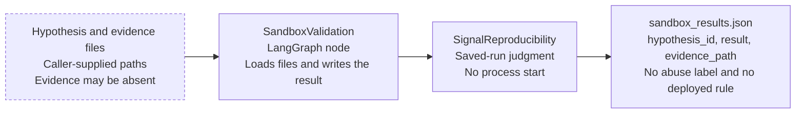

# LOCAL-sandbox-validation Sandbox Validation

Solution skeleton spec

Sources: `requirements/LOCAL-sandbox-validation/` and `requirements/LOCAL-sandbox-validation/plan/design-decisions.md`. Plan: `requirements/LOCAL-sandbox-validation/plan/plan.md`.

---

## Architecture

This change adds package `sandbox_validation`. A caller supplies a hypothesis file and a saved evidence file. One LangGraph node loads both through a LangChain runnable, asks `SignalReproducibility` for `support`, `contradict`, `inconclusive`, or `blocked`, and writes `sandbox_results.json`. A missing evidence file is `blocked`. The node does not launch Muse, browser-use, WebArena, or a shopping agent, and it does not import another component package.

Arrows are runtime flow for this change.

### Building blocks

| Building block | Scope | Boundary | Allowed dependencies |
|----------------|-------|----------|----------------------|
| `SandboxValidation` | Load the hypothesis and evidence, invoke the graph, write `sandbox_results.json` | Does not score runs and does not launch an agent | LangGraph, LangChain runnable, `SignalReproducibility`, the local filesystem |
| `SignalReproducibility` | Map saved runs to `support`, `contradict`, `inconclusive`, or `blocked` | Does not read the shopping page and does not write the result file | Python standard library |
| Saved evidence file | Manual sandbox observations already on disk | Not created by this package | None |

---

## Decision record

### DD-001 — One LangGraph node in `sandbox_validation` loads files through a LangChain runnable

| Field | Recorded value |
|-------|----------------|
| Status | DECIDED |
| Rationale | ADR 0001 selects LangChain for runnable calls and LangGraph for the stage graph. |
| Evidence | `docs/adr/0001-langchain-langgraph.md`, ASS-ARCH-001, architecture validator confidence high |
| Alternatives considered | A plain function matches `research_orchestrator` and drops the accepted framework for this package. |
| Consequences | The environment must provide `langgraph` and `langchain-core`. The node writes no checkpoint files. |
| Affected plan steps | Step 1, Step 3 |

### DD-002 — Missing or unusable evidence writes `blocked` and starts no browser

| Field | Recorded value |
|-------|----------------|
| Status | DECIDED |
| Rationale | Missing evidence is blocked rather than a launched browser. |
| Evidence | REQ-002, POL-001, CON-006, user decision 2026-11-20 |
| Alternatives considered | Launching WebArena when the file is missing is forbidden. |
| Consequences | A person must place the evidence file before a non-blocked result is possible. |
| Affected plan steps | Step 2, Step 3 |

### DD-003 — Saved runs use the provisional four-of-five rule on `telemetry_present` and `signal_observed`

| Field | Recorded value |
|-------|----------------|
| Status | REQUIRES_ACK |
| Rationale | The reasoning-loop stopping rule is provisional, and the user did not publish a different threshold. |
| Evidence | POL-002, REQ-003, REQ-004, REQ-005, ASS-002 |
| Alternatives considered | Copying a result field from the file skips the reproducibility rule. Requiring ten runs ignores a threshold met at five. |
| Consequences | A file with different field names is `blocked`. Acknowledgement is required before implementation. |
| Affected plan steps | Step 2 |

### DD-004 — The package does not import another component package

| Field | Recorded value |
|-------|----------------|
| Status | DECIDED |
| Rationale | The user forbade other component imports, and agents do not talk to each other. |
| Evidence | CON-003, CON-004, user decision 2026-11-20 |
| Alternatives considered | Calling the orchestrator to fetch the hypothesis couples the packages. |
| Consequences | Callers pass file paths. |
| Affected plan steps | Step 1 |

### DD-005 — `sandbox_results.json` has only `hypothesis_id`, `result`, and `evidence_path`

| Field | Recorded value |
|-------|----------------|
| Status | DECIDED |
| Rationale | The user named those three fields. |
| Evidence | REQ-001, INV-002, CON-005 |
| Alternatives considered | Embedding the runs adds fields the user did not request. |
| Consequences | A second run overwrites the same file name. |
| Affected plan steps | Step 3 |

### DD-006 — No abuse classification, deployed rule, faculty report, or agent chat

| Field | Recorded value |
|-------|----------------|
| Status | DECIDED |
| Rationale | The user excluded those outcomes. |
| Evidence | REQ-006, CON-004, CON-007, user decision 2026-11-20 |
| Alternatives considered | An abuse label when the hypothesis mentions abuse is the deferred classification. |
| Consequences | One run writes only `sandbox_results.json`. |
| Affected plan steps | Step 3 |

---

## Risks

**Implementation acknowledgement and risks:** READY_FOR_IMPLEMENTATION_WITH_ACK. The acknowledgement reason is that the four-of-five rule is provisional and the evidence JSON fields are inferred. Implementation of DD-003 waits for `proceed_as_is` or `risk_resolved`.

Carried design risks: 1

| ID | Risk | Effect | Mitigation |
|----|------|--------|------------|
| ASS-002 | Saved evidence is judged only when `runs` contain `telemetry_present` and `signal_observed`. | A differently shaped file becomes `blocked`. | Do not guess observations. The user acknowledgement covers proceeding with this shape. |
